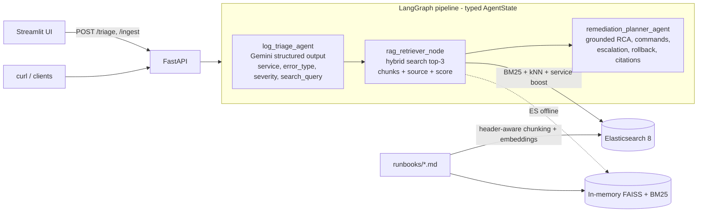

# OpsMind AI: Agentic SRE Incident Triage & Runbook Assistant

Paste a raw error log; get a structured, **runbook-grounded** RCA with CLI commands, escalation/rollback guidance, and citations. Built with FastAPI, LangGraph, Gemini, Elasticsearch hybrid search (FAISS fallback), and Streamlit.

## Architecture



**Grounding guardrails:** no retrieved chunks -> planner LLM is skipped and a "no matching runbook" plan is returned; the LLM is told to answer only from excerpts; citations not in the retrieved set are stripped, and a plan with no valid citation is downgraded to `runbook_found=false`; logs are treated as untrusted data (prompt-injection resistant instructions).

## Quick start (Docker)

```bash
cp .env.example .env          # set GEMINI_API_KEY
docker compose up --build
```

- UI: http://localhost:8501
- API docs (OpenAPI): http://localhost:8000/docs
- Elasticsearch: http://localhost:9200

Runbooks are indexed automatically on backend start (when the key is set) or on demand via `POST /ingest`.

## Local development

```bash
python3.11 -m venv .venv && source .venv/bin/activate
pip install -r requirements.txt
cp .env.example .env                       # set GEMINI_API_KEY
docker compose up -d elasticsearch         # optional; omit to use the FAISS fallback
uvicorn app.main:app --reload
BACKEND_URL=http://localhost:8000 streamlit run ui/dashboard.py
pytest -q                                  # fully mocked, no key or network needed
```

## API examples

```bash
curl -s localhost:8000/health

curl -s -X POST localhost:8000/ingest

curl -s -X POST localhost:8000/triage -H 'Content-Type: application/json' \
  -d "$(jq -Rs '{log: .}' sample_logs/kafka-consumer-lag.log)" | jq
```

Inline example:

```bash
curl -s -X POST localhost:8000/triage -H 'Content-Type: application/json' -d '{
  "log": "OOM command not allowed when used memory > '\''maxmemory'\''. used_memory=4294967296 maxmemory_policy=noeviction"
}' | jq '.triage, .plan.citations'
```

Response shape: `triage` (`affected_service`, `error_type`, `severity`, `search_query`), `retrieved[]` (`source`, `heading`, `score`, `content`), `retrieval_backend`, `plan` (`runbook_found`, `root_cause_hypothesis`, `steps[]`, `escalation`, `rollback`, `citations[]`), `trace[]`.

Errors: `422` invalid input, `503` provider not configured (e.g. missing `GEMINI_API_KEY`), `502` LLM/retrieval backend failure, `404` no runbooks found on ingest.

## Layout notes

| Path | Role |
| --- | --- |
| `app/config.py` | `BaseSettings` + provider factories (`build_chat_model`, `build_embeddings`) |
| `app/schemas.py` | API models, LLM structured-output models, `AgentState` TypedDict |
| `app/rag_pipeline.py` | Header-aware chunking, embeddings, ES index/hybrid search, FAISS fallback |
| `app/agents.py` | The 3-node LangGraph workflow |
| `app/main.py` | FastAPI endpoints |
| `runbooks/` | Markdown SOPs with front matter (`services:` drives metadata boosting) |

**Hybrid search:** Elasticsearch basic license has no RRF, so ranking is a linear sum of BM25 (`multi_match`, heading boosted) + kNN (cosine, boosted via `ES_KNN_BOOST`) + a constant boost for chunks tagged with the triaged service. The FAISS fallback fuses min-max-normalised cosine and BM25 plus the same service boost. Tune boosts in `app/config.py`.

**Add a runbook:** drop a `.md` file with front matter (`title`, `services`) in `runbooks/`, then `POST /ingest`.

**Swap providers:** add a branch in `build_chat_model` / `build_embeddings` (any LangChain chat model supporting `with_structured_output`) and set `LLM_PROVIDER`. The ES vector dimension is derived from the embedding model automatically; re-ingest after changing models.

## Known limits

- Runbook content in this repo is illustrative; validate commands against your environment before use.
- Ingest is full-reindex (index dropped and recreated); fine for tens of runbooks.
- No auth on the API: put it behind your gateway before exposing it.
